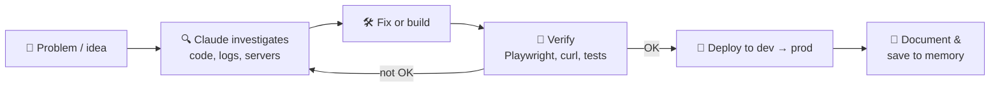

---

### 👋 About me

- 📍 Based in **Argentina**
- 🗣️ I work comfortably in **Español** and **English**
- 🔧 I bridge **developers, servers and clients**: I make sure what gets built actually runs well in production
- 🤖 I use **Claude Code** daily as a pair-programmer, auditor and automation engine
- 🚀 Currently focused on web projects, security hardening, integrations and automation
- 🎮 Game portfolio: **[ducampcarlos.carrd.co](https://ducampcarlos.carrd.co/)**
- 📫 Reach me: **[ducampcarlos@gmail.com](mailto:ducampcarlos@gmail.com)**

---

### 🛠️ Tech stack

---

### 🤖 Building with Claude

I don't just "ask AI for code": I use **Claude Code** as part of a real engineering workflow: investigate, fix, verify, document. These are the areas where it's been most useful for me:

<table>
<tr>
<td width="50%" valign="top">

#### 🖥️ Servers & infrastructure
- SSL certificates for multiple domains
- SMTP / mail-server certificate and delivery issues
- Dev vs. prod environment parity (endpoints, network, config)
- Production deploys and branch sync (`main` = prod, `dev` = staging)
- `.env` / secrets organization and hygiene

</td>
<td width="50%" valign="top">

#### 🔐 Security
- Reviewing penetration-test reports and turning them into action items
- Investigating API attack vectors and documenting findings
- Debugging auth flows (JWT claims, user lookups, roles & permissions)
- Hardening checks: auth errors, exposed endpoints, MFA gaps
- Turning that experience into an open-source tool: [SiteCheckup](https://github.com/ducampcarlos/SiteCheckup)

</td>
</tr>
<tr>
<td width="50%" valign="top">

#### 🔌 Integrations & APIs
- Connecting web apps to legacy **SOAP / WAN** web services
- Debugging pagination and empty-response issues on third-party endpoints
- Pricing / price-list features, from endpoint to UI
- Scoping work: proposals with task breakdowns and hour estimates

</td>
<td width="50%" valign="top">

#### 🔎 SEO & QA automation
- Full-site audits with **Playwright** (broken sitemap URLs, missing titles, wrong status codes)
- Dynamic sitemap generation for product catalogs
- Automated screenshots & evidence for client reports
- Product-upload guides and content automation

</td>
</tr>
<tr>
<td width="50%" valign="top">

#### 🌐 Web & front-end
- Marketing sites: navbar, hero sections, gradients, i18n, modals, mobile
- Laravel fixes (storage URLs, image loading across environments)
- Production verification after every release

</td>
<td width="50%" valign="top">

#### 🧩 AI tooling & agents
- Custom **MCP server on Cloudflare Workers** with OAuth, wired up as a Claude connector
- Workflows across Gmail, Calendar, Drive and Jira/Confluence connectors
- Persistent project **memory docs** so Claude keeps context between sessions
- Skills, hooks and automation around Claude Code itself
- Open source: [claude-ops-mcp](https://github.com/ducampcarlos/claude-ops-mcp), a read-only MCP server for server and website diagnostics, and [claude-job-hunter](https://github.com/ducampcarlos/claude-job-hunter), a Claude Code workspace built on skills

</td>
</tr>
</table>

#### 🔁 My loop

> 🎮 I also use Claude Code for game dev: my latest game project, **Liftest**, is being built that way.

---

### 📊 GitHub stats

---

### 📌 Featured projects

#### ⭐ New: SiteCheckup

> **A polite, passive CLI for the two moments a website is most likely to break: the day after a migration and the day a security report lands.**

- 🔍 **`audit`**: scored 0-100 security and hygiene report with concrete remediation steps
- 🔀 **`compare`**: validates a migration (missing pages, redirect chains and loops, changed titles and canonicals, `noindex` leftovers, lost headers, slower responses)
- 🛡️ Passive by design: GET/HEAD only, rate-limited, same-site redirects, and it refuses to run without `--i-have-permission`
- 🧪 Typed Python 3.11+, tests with no network access, coverage enforced in CI, and a Docker demo lab

| Project | What it is | Stack |
|---|---|---|
| **[SiteCheckup](https://github.com/ducampcarlos/SiteCheckup)** ⭐ | Passive CLI to audit a live site (31 checks: TLS, headers, cookies, exposed files, WordPress) and to compare an old site against its migrated replacement, URL by URL. Scored reports in HTML/JSON/Markdown, CI-friendly | `Python` `Typer` `httpx` `Docker` |
| **[claude-ops-mcp](https://github.com/ducampcarlos/claude-ops-mcp)** | Read-only MCP server that lets Claude run real diagnostics (TLS, HTTP, redirects, security headers, DNS, SPF/DKIM/DMARC, sitemaps). SSRF protection with DNS pinning, rate limits, audit log; stdio and HTTP transports, 242 tests | `TypeScript` `MCP` `Security` `Docker` |
| **[domainwatch](https://github.com/ducampcarlos/domainwatch)** | Self-hosted monitor for expiring certificates, uptime, DNS changes and SPF/DMARC. Dashboard, JSON API, Prometheus metrics and webhooks, with zero runtime dependencies | `TypeScript` `SQLite` `Prometheus` `Docker` |
| **[rack-defender](https://github.com/ducampcarlos/rack-defender)** | Data-centre tower-defence game for the browser. Deterministic engine balanced with a headless simulator, saves, tests and a real-browser end-to-end suite | `TypeScript` `Canvas` `Playwright` |
| **[mailcheck](https://github.com/ducampcarlos/mailcheck)** | Passive CLI that checks a domain's email authentication (SPF, DKIM, DMARC, MX, MTA-STS) and gives a score with a concrete fix for each problem | `Python` `DNS` `CI` |
| **[claude-job-hunter](https://github.com/ducampcarlos/claude-job-hunter)** | Claude Code workspace that prepares tailored job applications (CV, cover letter, interview prep) from your real profile, and never sends anything for you | `Claude Code` `Skills` `Python` |
| **[packet-catcher](https://github.com/ducampcarlos/packet-catcher)** | Tiny server-themed arcade game for the browser: catch the `200`s, dodge the `500`s. No dependencies | `JavaScript` `Canvas` |
| **Liftest** | Game project in active development, built with Claude Code 🎮 | `Game dev` |
| **[bidcom-frontend-challenge](https://github.com/ducampcarlos/bidcom-frontend-challenge)** | Front-end technical challenge | `Front-end` |
| **[nimble-challenge](https://github.com/ducampcarlos/nimble-challenge)** | Technical challenge | `Web` |
| **[PatagoniaJam](https://github.com/ducampcarlos/PatagoniaJam)** | Game built for the Patagonia Game Jam 🇦🇷 | `Unity` `C#` |
| **[Dodging-Dog](https://github.com/ducampcarlos/Dodging-Dog)** | My own take on the Dodging Dog game | `Unity` `C#` |
| **[Arkaless](https://github.com/ducampcarlos/Arkaless)** · **[Endless-Runner](https://github.com/ducampcarlos/Endless-Runner)** · **[Tappy-Ball](https://github.com/ducampcarlos/Tappy-Ball)** | Small arcade games and prototypes | `Unity` `C#` |
| **[Node-rest-api](https://github.com/ducampcarlos/Node-rest-api)** | REST API practice project | `Node.js` |

🎮 **More games and prototypes in my portfolio → [ducampcarlos.carrd.co](https://ducampcarlos.carrd.co/)**

> Most of my professional work (fintech, e-commerce, hosting and security) lives in private repos and client environments, so it's described above but not linked.

---

### 🌱 Now

- 🔭 Working on: *[SiteCheckup](https://github.com/ducampcarlos/SiteCheckup), web & server projects for clients, plus a game on the side*
- 🤖 Exploring: *MCP servers, agents and automation with Claude Code*
- 💬 Ask me about: web hosting, WordPress & Laravel security, deployments, SEO audits, API integrations, working with clients and dev teams

---

